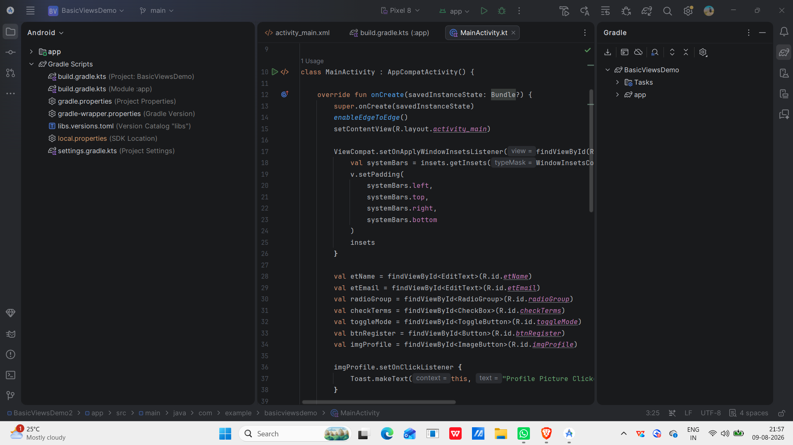
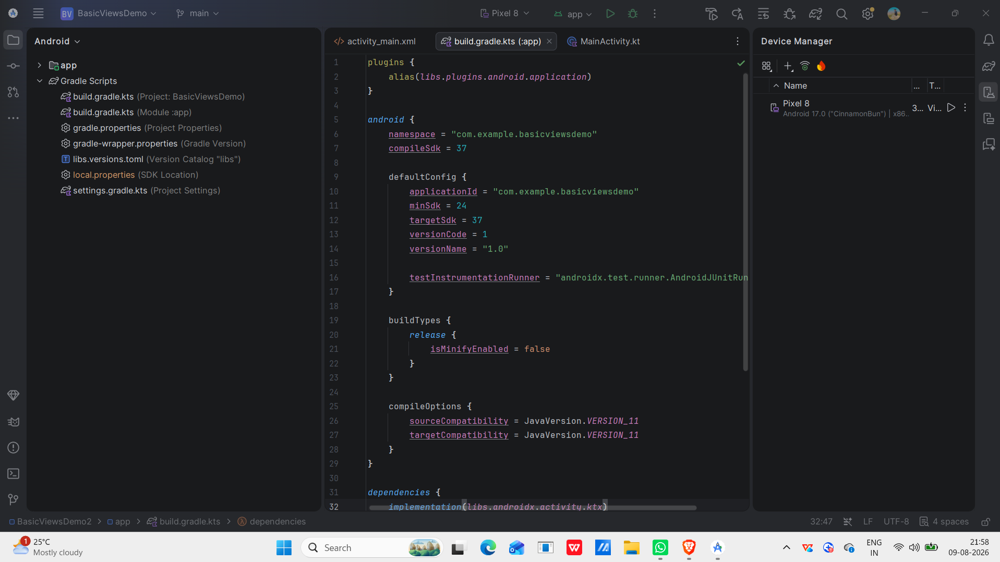
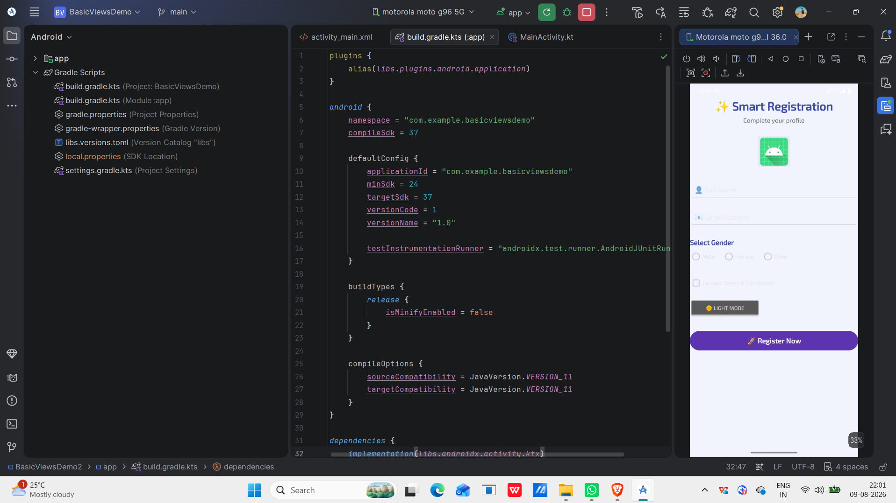
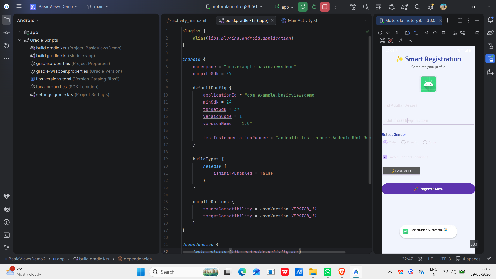

# Android Basic Views Demo

## Objective

To create an Android application using basic Views such as TextView, EditText, Button, ImageButton, CheckBox, ToggleButton, RadioButton, and RadioGroup.

---

## Concept

Android Views are UI components used to design and interact with an application's user interface. TextView displays text, EditText accepts user input, Button performs actions, ImageButton displays an image-based button, CheckBox allows multiple selections, ToggleButton provides an ON/OFF option, and RadioButton with RadioGroup allows the user to select one option from a group.

---

## Technology Used

- Kotlin
- Android Studio
- Android SDK
- XML Layout
- TextView
- EditText
- Button
- ImageButton
- CheckBox
- ToggleButton
- RadioButton
- RadioGroup

---

## Scenario

The application demonstrates a Smart Registration form. The user can enter their name and email, select a gender, accept the terms and conditions, interact with the profile ImageButton, and switch between Light Mode and Dark Mode using the ToggleButton. The Register button processes the entered details.

---

## Project Structure

```text
BasicViewsDemo/
│
├── app/
│   └── src/
│       └── main/
│           ├── java/
│           │   └── [package_name]/
│           │       └── MainActivity.kt
│           │
│           ├── res/
│           │   ├── drawable/
│           │           # Drawable resources
│           │   ├── layout/
│           │   │   └── activity_main.xml
│           │   └── values/
│           │       ├── colors.xml
│           │       ├── strings.xml
│           │       └── themes.xml
│           │
│           └── AndroidManifest.xml
│
├── screenshots/
│   ├── main_screen.png
│   ├── test_case_2.png
│   ├── test_case_3.png
│   └── output.png
│
├── build.gradle.kts
├── settings.gradle.kts
├── gradle.properties
├── gradlew
├── gradlew.bat
├── .gitignore
└── README.md
```

# Test Cases

## Test Case 1 – Main Screen

**Input:** Launch the application.

**Expected Output:** The Smart Registration screen is displayed with TextView, ImageButton, EditText, RadioButton, CheckBox, ToggleButton, and Register Button.



---

## Test Case 2 – User Input and Selection

**Input:** Enter name and email, select a gender, accept the Terms & Conditions, and interact with the ToggleButton.

**Expected Output:** The entered details are accepted and the selected options are displayed correctly.


---

## Test Case 3 – Registration and Name & USN Verification

**Input:** Enter valid registration details and click the Register button.

**Expected Output:** The registration is processed successfully. The screenshot also clearly shows the student's Name and USN for verification.



---

## Output

The application successfully demonstrates all the required basic Android Views and their interaction in a Smart Registration form.



---

## Conclusion

This experiment demonstrates the use of basic Android Views such as TextView, EditText, Button, ImageButton, CheckBox, ToggleButton, RadioButton, and RadioGroup. The application successfully provides an interactive registration form using these UI components.
